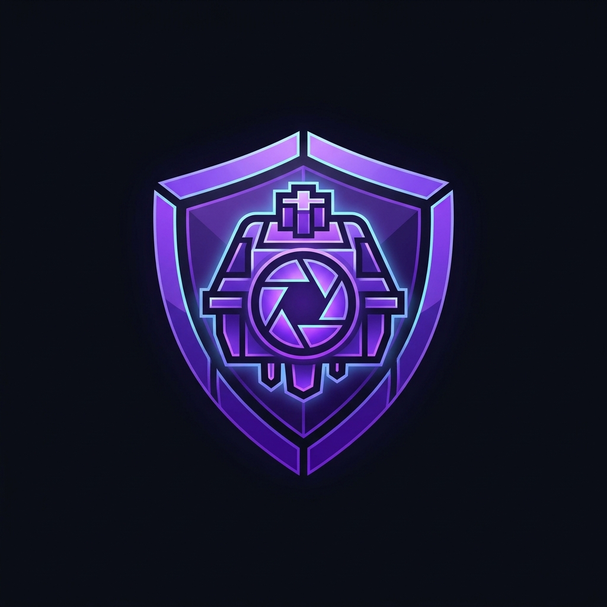

# mrSpyCC

<p align="center">
  
</p>

<p align="center">
  <strong>Gelişmiş Kontrol Merkezi & ITE8291 RGB Donanım Motoru</strong><br>
  <em>Advanced Control Center & ITE8291 RGB Hardware Engine</em><br>
  <sub>Tongfang / AiStone / Game Garaj Barebone Cihazlar İçin Yüksek FPS, Taşınabilir Tek .EXE Kontrol Süiti</sub>
</p>

<p align="center">
  <a href="https://github.com/MrSpy00/mrSpyCC/releases"></a>
  <a href="https://github.com/MrSpy00/mrSpyCC/blob/main/LICENSE"></a>
  <a href="https://dotnet.microsoft.com/download/dotnet/10.0"></a>
  <a href="https://aegissoft.com.tr"></a>
  <a href="https://github.com/MrSpy00"></a>
</p>

<p align="center">
  <a href="#-türkçe"><strong>🇹🇷 Türkçe Dokümantasyon</strong></a> • 
  <a href="#-english"><strong>🇬🇧 English Documentation</strong></a>
</p>

---

# 🇹🇷 Türkçe

## ⚡ Genel Bakış ve Amaç

**mrSpyCC PRO v1.0**, Tongfang / AiStone kasalı oyuncu dizüstü bilgisayarlarında (Game Garaj Slayer serisi, XMG Apex 16 Max, Schenker, Medion Erazer Major vb.) yer alan **ITE8291 USB HID RGB klavye denetleyicisini** (`VID_048D / PID_600B / MI_01`) yönetmek üzere **[aegisSoft](https://aegissoft.com.tr)** ve **[mrSpy](https://github.com/MrSpy00)** tarafından C# / .NET 10 ve saf Win32 API'leri ile geliştirilmiş bağımsız bir kontrol merkezidir.

Resmi üretici yazılımlarının (Control Center / GCUBridge) ağır bellek tüketimini, düşük FPS animasyon takılmalarını ve hantal arayüzünü tamamen ortadan kaldırır. Bilgisayara hiçbir ek kütüphane veya runtime kurulumu gerektirmeyen **tek bir taşınabilir `.exe` (Portable Single-File)** olarak çalışır; kayıt defterinde çöp bırakmaz.

---

## 🚀 Öne Çıkan Özellikler

### 🐾 1. Canlı Varlıklar & Bilişsel Simülasyonlar
* **Canlı Gözler (Living Eyes):** Klavye ortasında fare imlecini masaüstünde takip eden iki organik göz. Doğal mikro-seğirmeler (mikro-sakkadlar), meraklı bakışlar, hızlı yazımda odaklanmış kedi gözü formu ve 14 saniye boşta kalınca uykuya dalarak F tuşlarına doğru süzülen mavi `Zzz` rüya parçacıkları.
* **Sanal Evcil Hayvan (Cyber Tamagotchi):** 4 aşamalı evrim sistemi (Yumurta $\to$ Bebek $\to$ Çocuk $\to$ Efsanevi Ejderha). Basılan tuşlardaki neon kırıntılara atlayıp yiyen, fareyle sevildiğinde mırıldanıp kalpler saçan yaşayan varlık. F tuşlarında gerçek zamanlı Açlık/Mutluluk/EXP göstergeleri.
* **Siber Yoldaş (Keyboard Buddy):** Tuş sütunlarını merdiven gibi tırmanan, yazım hızınıza (WPM) göre arkasında gökkuşağı renginde jet dumanı bırakan robot yoldaş.
* **Ruh Hali Canlısı (Mood Creature):** CPU kullanımı ve WASAPI ses baslarına göre renk ve nabız değiştiren simbiyotik organizma.
* **Siber Gece Baykuşu (Cyber Owl):** F tuşlarında tüneyen, farenin hareketine göre kafasını çevirip göz kırpan, tuşlara basıldığında kanatlarını çırpan bilge baykuş.
* **Karınca Kolonisi (Swarm Life):** Köşelerdeki yuvalardan çıkan ve bastığınız tuşlardaki besin kırıntılarını feromon kokusuyla toplayan otonom 20 karınca ajanı.

### 🎮 2. Klavyede Oynanabilir Mini Oyunlar (3 Saniye Auto-Restart)
> [!NOTE]
> Tüm mini oyunlar kilitlenme korumalıdır: yanma anında F1-F12 üzerinde 3 saniyelik görsel geri sayım yanar ve oyun otomatik olarak yeniden başlar.
* **Dinozor Koşusu (T-Rex Runner):** Space tuşuna basılı tutma süresine göre değişken zıplama yüksekliği, küçük/büyük kaktüsler, uçan kuşlar ve F-tuşlarında canlı skor.
* **Yılan Oyunu (Classic Snake):** 6x21 klavye matrisinde yön tuşlarıyla oynanan, yem yedikçe uzayan ve sindirim dalgası parlayan yılan oyunu.
* **Uzay İstilacıları (Space Invaders):** Savunma sığınakları, uzaylı lazer bombaları ve en üstten geçen bonus kırmızı Ana Gemi (UFO).
* **Tuğla Kırma (Cyber Arkanoid):** Üst iki satırdaki renkli tuğlaları seken topla kırma, 3 can hakkı ve zafer kutlaması.
* **Uçan Kuş (Flappy Bird):** Space ile kanat çırparak yeşil boru sütunlarının arasından süzülme refleks oyunu.
* **Köstebek Vurmaca (Whack-A-Mole):** Rastgele beliren neon pembe köstebeklere hızla basarak vurma oyunu.
* **Retro Tenis (Pong):** AI rakibe karşı falso fizik motorlu raket maçı.
* **Tepki Testi & Yazı Yağmuru:** Milisaniye hassasiyetinde refleks ölçümü ve yazılan tuşlardan alt sırada biriken neon su birikintisi.

### 🌊 3. Fizik, Egzotik ve Doğa Simülasyonları
* **Akışkanlar Mekaniği (Fluid Dynamics):** Sürekli Gauss dalga paketi süperpozisyonu ve üstel viskozite sönümlemesiyle gerçeğe yakın su/okyanus simülasyonu.
* **Plazma & Kara Delik:** Kütleçekimsel yığılma diski, olay ufku çöküşü ve süpernova patlamaları.
* **Conway Hücresel Otomatı (Game of Life):** Üreyen, çoğalan ve birbirini yok eden canlı piksel hücreleri.
* **WASAPI Loopback 16-Bant Ses Spektrumu:** Çalan müzik veya oyun seslerini logaritmik FFT motoruyla ayrıştırıp tuş sütunlarına yansıtan görsel ekolayzır.

### 🎨 4. Global Renk Stüdyosu (`GlobalColorProcessor`)
* **Tek Renk / Çift Renk / Tam RGB:** 50+ efektin tamamını tek tıkla seçilen tek özel renge, 2-renkli akıllı geçişe veya 360° gökkuşağı dalgasına uyarlama.
* **8 Küratörlü Stüdyo Paleti:** Cyberpunk 2077, aegisSoft Obsidian, Miami Synthwave, Aurora, Volkanik Magma, Tokyo Gece Yarısı, Matrix ve Kraliyet Altını.
* **Per-Key Fırça Boyama:** Sürükle-bırak destekli çoklu tuş boyama ve profil saklama.
* **Tam Donanım Eşleşmesi:** Game Garaj Slayer / Tongfang ISO klavyelerdeki `Sc` (Scroll Lock / FnLock, Ofset 333) tuşu ve Çift LED'li ISO Enter tuşu (`349` ve `321`) kusursuz hizalanmıştır.

### 🛡️ 5. Kurumsal Sistem & Donanım Güvenliği
* **GCUBridge Arbitrasyonu:** Üretici servisinin fan ve güç tablolarını kesintiye uğratmadan klavye RGB denetimini devralan özel Win32 kilit mimarisi.
* **Hibrit Oto-Başlatma:** UAC onayı istemeyen Windows Görev Zamanlayıcı görevi (`mrSpyCC_AutoStart`) ve Görev Yöneticisi Başlangıç entegrasyonu.
* **Explorer Çökme Korumalı Sistem Tepsisi:** Windows kabuğu veya `explorer.exe` yeniden başladığında tepsiyi otomatik onarma.
* **Zero-Allocation Optimizasyonu:** Ses gerektirmeyen modlarda FFT motorunu uyutarak sıfır arka plan CPU tüketimi.

---

## 📦 Kaynak Koddan Derleme

### Gereksinimler
* Windows 10 / 11 x64
* .NET 10.0 SDK (`v10.0.402` veya üzeri)
* PowerShell 5.1+ / 7+

### 1. Depoyu klonlayın
```bash
git clone https://github.com/MrSpy00/mrSpyCC.git
cd mrSpyCC
```

### 2. Derleme ve Paketleme
```powershell
# Otomatik bağımsız tek-dosya derleme betiğini çalıştırın:
.\build.ps1

# Veya standart dotnet publish komutuyla:
dotnet publish src\mrSpyCC\mrSpyCC.csproj -c Release -r win-x64 --self-contained -p:PublishSingleFile=true -p:IncludeNativeLibrariesForSelfExtract=true -p:EnableCompressionInSingleFile=true -o build\dist
```

Üretilen çalıştırılabilir dosya:
* `build\dist\mrSpyCC.exe` *(Kurulum gerektirmeyen bağımsız 64 MB portable ikili)*

---

# 🇬🇧 English

## ⚡ Overview & Purpose

**mrSpyCC PRO v1.0** is an enterprise-grade, high-performance control center and RGB hardware engine designed for Tongfang / AiStone barebone gaming laptops (Game Garaj Slayer series, XMG Apex 16 Max, Schenker, Medion Erazer Major, etc.) equipped with the **ITE8291 USB HID RGB keyboard controller** (`VID_048D / PID_600B / MI_01`).

Developed by **[aegisSoft](https://aegissoft.com.tr)** and **[mrSpy](https://github.com/MrSpy00)** in C# / .NET 10 with pure Win32 Core APIs, mrSpyCC eliminates the heavy background footprint, low frame-rate stutter, and bloat of OEM software (Control Center / GCUBridge). It runs as a **single, portable, self-contained executable** with zero external dependencies and zero registry pollution.

---

## 🚀 Key Highlights

### 🐾 1. Cyber Entities & Cognitive Simulations
* **Living Eyes:** Two organic eyes centered on the keyboard tracking the mouse cursor across your desktop via Win32 `GetCursorPos`. Features micro-saccades, curious key glances, focused slit pupils during high WPM typing, and a sleepy state drifting into blue `Zzz` dream particles toward the function row after 14 seconds of inactivity.
* **Virtual Pet (Cyber Tamagotchi):** 4-stage evolutionary companion (Egg $\to$ Baby $\to$ Teen $\to$ Legendary Dragon). Pounces on neon crumbs left by keypresses, purrs and emits pink hearts when petted with the cursor, and displays real-time Hunger/Happiness/EXP HUDs on the F1-F12 keys.
* **Keyboard Buddy:** Climbs key columns like ladders and emits a rainbow jet trail proportional to your typing speed.
* **Mood Creature:** Symbiotic organism morphing its pulse and color scheme according to real-time CPU telemetry and WASAPI bass response.
* **Cyber Owl & Ant Colony:** Wise owl reacting to typing with wing flutters and 20 autonomous ants foraging keypress crumbs using pheromone trails.

### 🎮 2. On-Keyboard Mini-Games (3-Second Auto-Restart)
> [!NOTE]
> All mini-games are deadlock-proof: on collision or game over, an animated 3-second golden/crimson countdown bar sweeps across F1-F12 before automatically rebooting the game.
* **T-Rex Dino Runner:** Variable jump height based on Space-bar hold duration, obstacles (cacti, pterodactyls), and live score on F-keys.
* **Classic Snake:** 6x21 matrix snake with direction-oriented eyes, timed golden apples, and glowing digestion pulses along the tail.
* **Space Invaders:** Player ship, 3 destructible bunkers, alien laser bombs, and top-row red Mothership (UFO) bonuses.
* **Cyber Arkanoid & Flappy Bird:** Ball deflection physics, brick shattering sparks, and gravity-driven pipe navigation.
* **Whack-A-Mole, Pong & Reaction Test:** Millisecond-accurate reflex benchmarking directly on mechanical laptop keys.

### 🌊 3. Physics & Exotic Simulations
* **Fluid Dynamics:** Gaussian wave packet superposition with exponential viscosity damping simulating organic ocean waves.
* **Plasma & Black Hole:** Multi-harmonic 2D interference, relativistic accretion disks, and supernova explosions.
* **Conway's Game of Life:** Cellular automaton reproducing and evolving across your keyboard matrix.
* **WASAPI Loopback 16-Band Audio Visualizer:** Zero-latency audio spectrum visualizer powered by a Radix-2 Cooley-Tukey FFT engine.

### 🎨 4. Global Color Studio (`GlobalColorProcessor`)
* **Single / Dual / Full 360° RGB:** Transform all 50+ effects into a custom single color, intelligent two-tone gradient, or synchronized RGB wave.
* **8 Curated Hardware Palettes:** Cyberpunk 2077, aegisSoft Obsidian, Miami Synthwave, Aurora, Volcanic Magma, Tokyo Midnight, Emerald Matrix, and Royal Gold.
* **Per-Key Studio Painter:** Drag-and-brush freehand key coloring with custom profile persistence.
* **Complete Physical Matrix Parity:** Full alignment for the Tongfang / Game Garaj Slayer `Sc` key (Offset 333) and Dual-LED ISO Enter key (`349` / `321`).

### 🛡️ 5. System Integrity & Hardware Arbitration
* **GCUBridge Arbitration:** Exclusive Win32 device locking that isolates RGB control without interrupting vendor fan curves or power profiles.
* **Hybrid Auto-Start:** UAC-bypassing Windows Task Scheduler task (`mrSpyCC_AutoStart`) synchronized with Task Manager Startup items.
* **Crash-Resilient System Tray:** Re-registers tray icons automatically if Windows Explorer restarts.
* **Zero-Allocation Architecture:** Automatically suspends audio capturing and WPF dispatching when minimized or idle.

---

## 🛠️ Architecture & System Map

```text
mrSpyCC/
├── build.ps1                                 # Automated Release packaging script
├── mrSpyCC.slnx                              # Visual Studio solution file
├── resources/                                # High-resolution icons & artwork
│   ├── logo.png                              # 1024x1024 aegisSoft mrSpyCC Cyber Logo
│   └── app.ico                               # Multi-layer Windows application icon
│
└── src/mrSpyCC/
    ├── App.xaml / MainWindow.xaml            # Cyberpunk WPF UI & Tray manager
    ├── Core/
    │   ├── Device/                           # Ite8291Device, NativeHid (8x64 USB HID reports)
    │   ├── VendorLock/                       # GCUBridge arbitrator & TaskScheduler helper
    │   ├── KeyMatrix/                        # KeyMapTable, physical 105-key layout & ISO Enter
    │   ├── Input/                            # LowLevelKeyboardHook (WH_KEYBOARD_LL) & MouseTracker
    │   ├── Audio/                            # WasapiAudioCapture & Cooley-Tukey 16-band FFT
    │   ├── Engine/                           # 31.25 FPS multimedia frame pacer & FrameBuffer
    │   └── Effects/                          # 50+ animations, mini-games & cyber entities
    └── UI/                                   # VirtualKeyboard, ColorPicker & ViewModels
```

---

## 📦 Building from Source

### Prerequisites
* Windows 10 / 11 x64
* .NET 10.0 SDK (`v10.0.402` or later)
* PowerShell 5.1+ / 7+

### Build Steps
```powershell
# Clone the repository
git clone https://github.com/MrSpy00/mrSpyCC.git
cd mrSpyCC

# Build standalone portable executable
.\build.ps1
```

The compiled binary will be placed at:
* `build\dist\mrSpyCC.exe` *(64 MB standalone self-contained portable executable)*

---

## 📜 Lisans & Yasal Uyarı / License & Legal

Bu proje **MIT Lisansı** ile lisanslanmıştır — detaylar için [LICENSE](LICENSE) dosyasına göz atabilirsiniz.

### Yasal Uyarı / Disclaimer
*mrSpyCC, aegisSoft tarafından bağımsız olarak geliştirilmiş açık kaynaklı bir donanım kontrol süitidir. Tongfang, AiStone, ITE Tech veya Game Garaj markalarıyla doğrudan bir kurumsal bağı veya ortaklığı yoktur.*  
*Tüm ticari markalar ve tescilli isimler ilgili sahiplerine aittir.*

---

<p align="center">
  Geliştirici / Developed by <strong><a href="https://aegissoft.com.tr">aegisSoft</a></strong> & <strong><a href="https://github.com/MrSpy00">mrSpy</a></strong>
</p>
